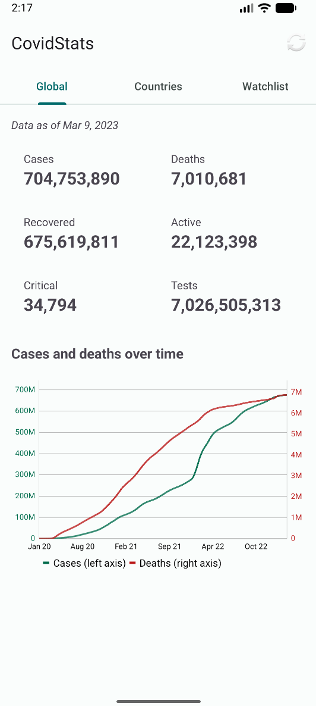
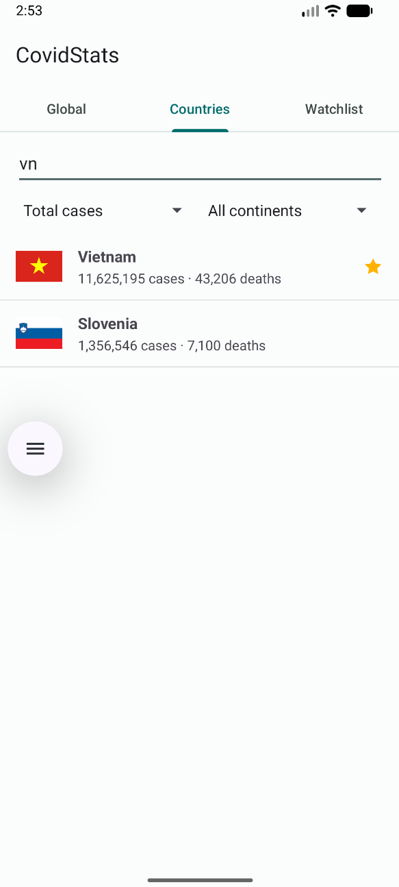
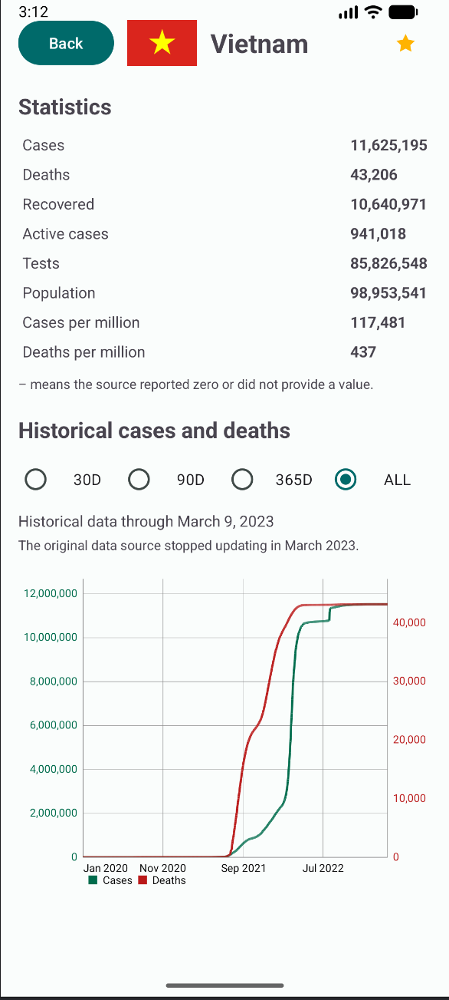
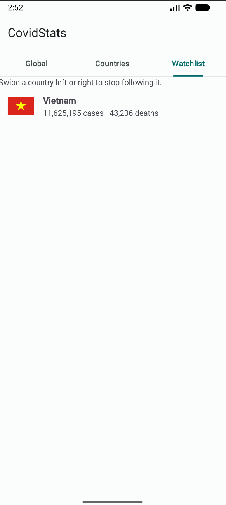
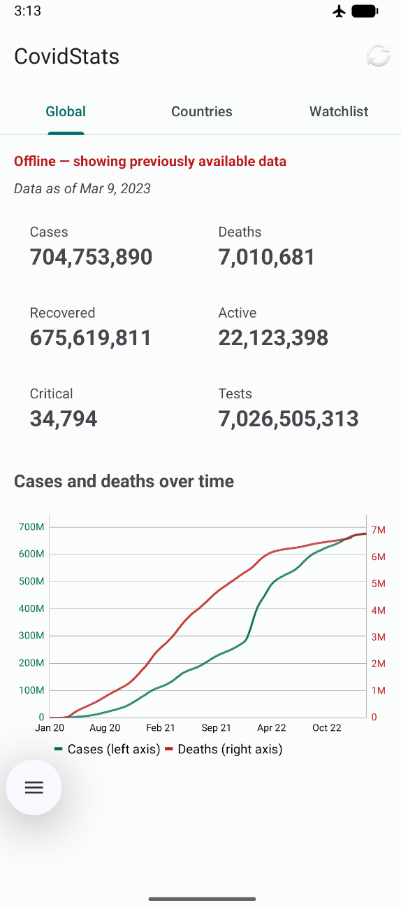

# COVID-19 Stats

An Android app that shows global and per-country COVID-19 statistics, fetched over HTTPS from the public [disease.sh](https://disease.sh) REST API.

**Project 14 — Mobile Application Development, ICT Department, USTH.**

---

## Features

| | Feature | Description |
|---|---|---|
| F01 | Global statistics | Total cases, deaths, recoveries, active and critical cases, tests |
| F02 | Country list | ~231 countries with flags, scrolled with `RecyclerView` |
| F03 | Search | Filter as you type; matches country name, ISO2 and ISO3 code |
| F04 | Country detail | Flag, population and eight key figures for one country |
| F05 | Refresh | Toolbar button and pull-to-refresh |
| F06 | Error handling | Readable message and a Retry button on network or server failure |
| F07 | History chart | Cases and deaths over 30 / 90 / 365 days or the full history |
| F08 | Bilingual UI | English and Vietnamese, follows the system language |
| F11 | Watchlist | Star countries; the list survives app restarts |
| F12 | Offline cache | Last successful response is shown with an "offline" notice |
| F09 | Sorting | By total cases, deaths, cases per million, or name |
| F10 | Continent filter | Show one continent or all |
| F13 | Gestures | Swipe to remove from the watchlist, long-press to add, pinch to zoom the chart |

F01–F08, F11 and F12 are required. F09, F10 and F13 are added only once the required set is stable.

## Screenshots

| Global | Search | Country detail | Watchlist | Offline |
|---|---|---|---|---|
|  |  |  |  |  |

---

## Requirements

| | |
|---|---|
| IDE | Android Studio Giraffe (2022.3) or newer |
| JDK | 17 — bundled with Android Studio |
| Language | Java |
| Min SDK | 24 (Android 7.0) |
| Test device | Emulator API 30–34 x86_64, or a physical Android device over USB |

No API key is needed — disease.sh is open and unauthenticated.

## Build and run

```bash
git clone https://github.com/hainguyen15022006-cmd/COVID-19-Stats-.git
cd COVID-19-Stats-
```

1. Open Android Studio → **File → Open** → select the cloned folder.
2. Wait for the Gradle sync to finish. The first sync downloads dependencies and may take several minutes.
3. Pick an emulator or a connected device in the toolbar.
4. Press **Run** (`⌃R` on macOS, `Shift+F10` on Windows/Linux).

**If the Gradle sync fails on MPAndroidChart**, make sure the JitPack repository is declared in `settings.gradle`:

```gradle
dependencyResolutionManagement {
    repositories {
        google()
        mavenCentral()
        maven { url 'https://jitpack.io' }
    }
}
```

## Tech stack

| Area | Choice |
|---|---|
| HTTP | Volley `1.2.1` |
| JSON | `org.json` (`JSONObject` / `JSONArray`) |
| Charts | MPAndroidChart `v3.1.0` (via JitPack) |
| Lists | `RecyclerView` with a `ViewHolder` |
| Navigation | `ViewPager` + `TabLayout`, three tabs |
| Images | Volley `ImageLoader` with an in-memory `LruCache` |
| Storage | JSON files in `getFilesDir()`; `SharedPreferences` for the watchlist |

## Permissions

```xml
<uses-permission android:name="android.permission.INTERNET" />
<uses-permission android:name="android.permission.ACCESS_NETWORK_STATE" />
```

Both are normal permissions, so no runtime permission request is needed. The app collects no personal data.

---

## Data source

Base URL: `https://disease.sh/v3/covid-19/`

| Endpoint | Used for |
|---|---|
| `/all` | Global tab |
| `/countries?sort=cases` | Country list |
| `/countries/{iso2}` | Country detail |
| `/historical/{iso2}?lastdays=all` | Country chart |
| `/historical/all?lastdays=all` | Global chart |
| `/continents` | Continent filter |

All endpoints were called and verified on **21 October 2026**. Sample responses are stored in `app/src/main/res/raw/` so the app can be demonstrated without a network connection.

### Important notes on the data

**The source stopped updating.** Johns Hopkins University ended its data collection in March 2023 and many countries stopped reporting. As a result `todayCases` and `todayDeaths` are `0` for nearly every country. This is a limitation of the data source, not a bug in the app.

**`updated` is not the data date.** The `updated` field holds the time the *server answered the request*, not the time the figures last changed — it is always "a few seconds ago". The app therefore takes the data date from the **last key in the `timeline` object** of `/historical`, and labels it "Data as of …". Where `updated` is shown at all, it is labelled "Fetched at".

**Country names are abbreviated.** The API returns `"USA"`, `"UK"` and `"S. Korea"` rather than full names, so search matches against `country`, `countryInfo.iso2` and `countryInfo.iso3`.

---

## Architecture

```
UI layer          Activities, Fragments, Adapters, layout XML
                  ↓ request                       ↑ callback on the main thread
Coordination      CovidRepository  (cache if fresh, otherwise call the API)
                  ↓                               ↓
Network           CovidApi (Volley)      Storage   CacheManager (getFilesDir)
                  JsonParser                       WatchlistStore (SharedPreferences)
                  ↓
Source            disease.sh
```

No Activity or Fragment calls the network directly. Every screen asks `CovidRepository`, which decides between the cache and a network call and returns the result through a callback on the main thread.

```java
interface Callback<T> {
    void onSuccess(T data, boolean fromCache);
    void onError(String message);
}

class CovidRepository {
    void getGlobal(boolean forceRefresh, Callback<GlobalStats> cb);
    void getCountries(boolean forceRefresh, Callback<List<CountryStats>> cb);
    void getCountry(String iso2, Callback<CountryStats> cb);
    void getHistory(String iso2OrAll, int days, Callback<HistoricalData> cb);
}
```

**Threading.** Volley performs the request on a background thread, but `onResponse()` runs on the main thread. Parsing ~231 country objects there would block the UI, so JSON parsing happens in `parseNetworkResponse()` of a `Request<T>` subclass, which runs on Volley's background thread. Cache reads and writes also run off the main thread. `StrictMode` is enabled in debug builds to catch violations.

## Project structure

```
app/src/main/java/vn/edu/usth/covidstats/
├── CovidApp.java              Application: shared RequestQueue and Repository
├── data/
│   ├── Callback.java
│   ├── CovidRepository.java
│   ├── CovidApi.java          Volley requests
│   ├── JsonParser.java        JSON → model, on a background thread
│   ├── CacheManager.java      JSON files in getFilesDir()
│   └── WatchlistStore.java    SharedPreferences
├── model/
│   ├── GlobalStats.java
│   ├── CountryStats.java
│   └── HistoricalData.java
├── ui/
│   ├── MainActivity.java      Toolbar + ViewPager + TabLayout
│   ├── GlobalFragment.java
│   ├── CountryListFragment.java
│   ├── WatchlistFragment.java
│   ├── CountryAdapter.java
│   └── CountryDetailActivity.java
└── util/
    ├── ChartHelper.java
    ├── Formatters.java        Locale-aware number and date formatting
    ├── CountryNameMatcher.java
    └── NetworkUtil.java

app/src/main/res/
├── layout/ · layout-land/
├── values/ · values-vi/       English and Vietnamese strings
├── drawable/
├── menu/
└── raw/                       Sample JSON for offline demo
```

---

## Team

| Member | Area |
|---|---|
| Trần Duy Hoàng Anh | Team lead: repository, documentation, release; utility classes |
| Tấn Thành | Networking, data contract, repository; maintains `main` |
| Công Dương | Caching, watchlist storage, Watchlist tab |
| Sỹ Chúc | Main screen, tab navigation, Global tab |
| Hải Anh | Country list, search, sorting, gestures; quality gate |
| Công Thành | Country detail screen and charts |
| Minh Sơn | Resources, localisation, rendering optimisation, slides |

## Known limitations

- The data source stopped updating in 2023, so daily figures are zero for most countries.
- Historical data for countries reported by province (for example China and Australia) uses a different response shape; the parser reports an error instead of crashing.
- The vaccination endpoint is not used.

## Course

Mobile Application Development, ICT Department, University of Science and Technology of Hanoi.
Course repository: [github.com/SonTG/androiddev2022](https://github.com/SonTG/androiddev2022)
